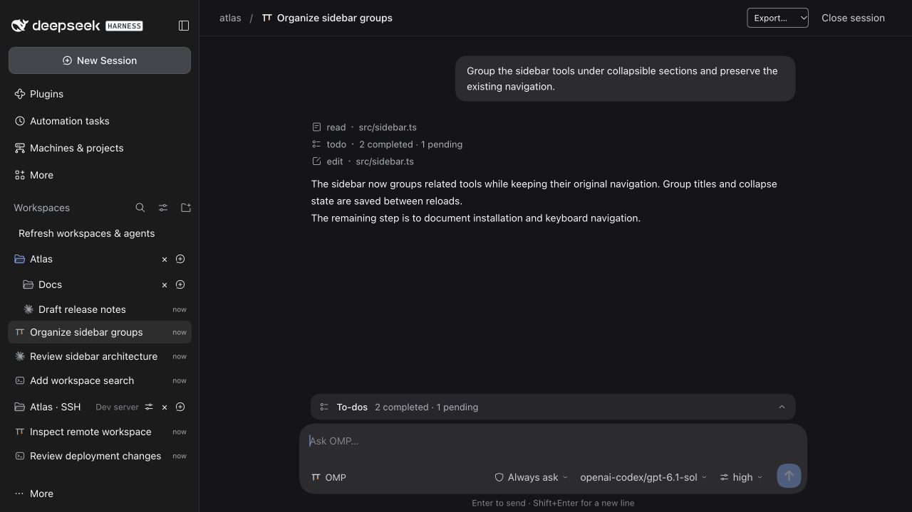
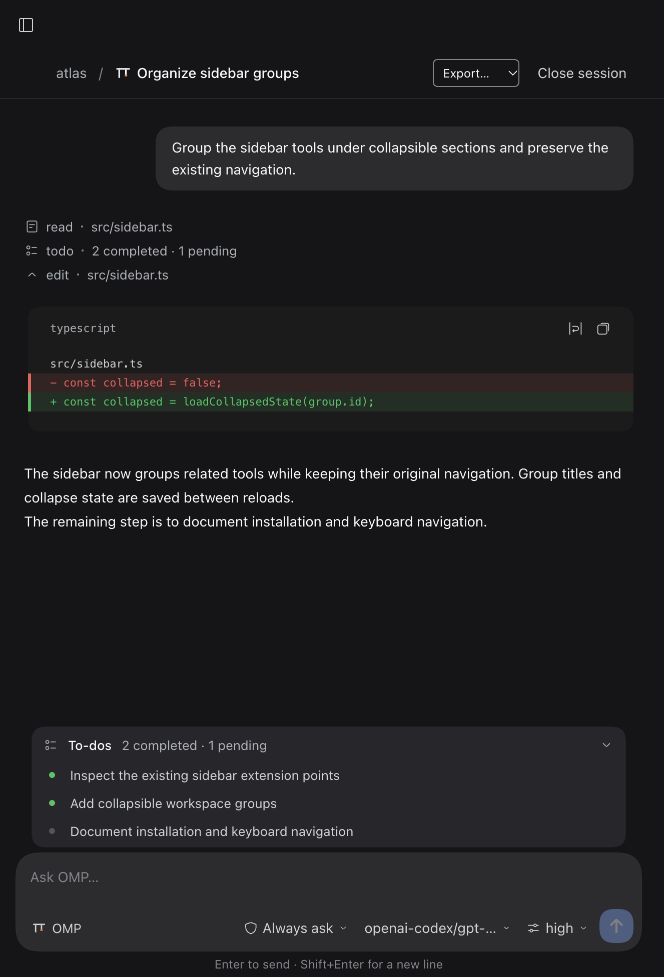
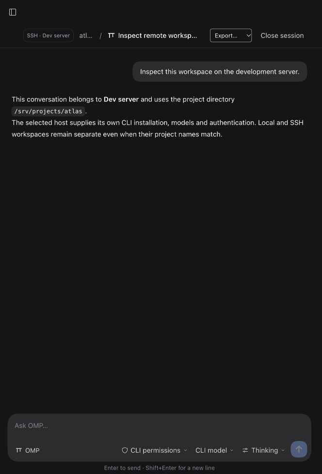

# DSH Remote Agents

Unified DSH workspaces for **Claude Code, Codex and OMP**, with local and SSH conversations, tool approvals and persistent history. Native DSH sessions share the same sidebar and retain their original conversation interface.

Unofficial community plugin, independently developed and maintained; not affiliated with DeepSeek. User messages and provider output are never translated or rewritten.

> **Rust backend (`0.5.0-alpha.5`).** `main` carries the Rust sidecar implementation. The stable npm `latest` channel is still the legacy JavaScript 0.4.1 release, and this alpha is distributed through the GitHub pre-release; the legacy JavaScript implementation (≤0.4.1) is frozen on the [`legacy-js`](https://github.com/FrankieeW/dsh-remote-agents/tree/legacy-js) branch. See [native architecture and builds](native/README.md).

### In the Rust build

- Rust-owned `/` commands in Claude Code, Codex and OMP conversations: searchable keyboard completion, status/help, model/effort/permissions, rename/pin/archive, fresh conversations, interruption and Markdown/JSON export. Commands retain drafts on failure and never become model prompts. See [conversation commands](docs/unified-chat.md#conversation-commands-rust-development-build).
- Per-conversation **Models** tab for OMP built-in/custom role assignments, project overrides, presets, provider connections and custom model definitions, scoped to that conversation's machine and workspace. Requires OMP 18.18.x for configuration management. See [OMP model configuration](docs/omp-model-configuration.md).
- Full tool archives for new local and SSH turns: browse 16-call pages, search complete inputs/results, read long values in UTF-8-safe pages and export a turn's full tools as JSONL. Older local OMP turns can recover from their original session files. See [tool history](docs/tool-history.md).
- Automatic titles from the first prompt, with manual rename protection and an explicit **Use automatic title** action.
- DSH-native conversation tabs tailored to each agent: Claude **Chat / Tools / To-dos**, Codex **Chat / Plan / Changes**, OMP **Chat / Tasks / Tools / Models**.
- Structured file diffs, tool filters, OMP task phases and agent-specific settings labels. The composer, drafts, approvals and interruption remain available across views.
- OMP semantic color accents for tools, phases, Markdown and thinking levels, following DSH's light/dark appearance.

See [agent views and automatic titles](docs/agent-ui.md) for behavior and limits.

## Screenshots

Captured from the actual **0.4.1** interface in an isolated demonstration profile. Conversations, project paths, and CLI/SSH responses use fixtures; the images contain no production conversations, credentials, personal paths or real server identities. They illustrate the interface, not live-server verification.

**Unified workspace sessions** — browse Claude Code, Codex and OMP conversations together, with nested local workspaces and a separate SSH workspace.



| OMP to-dos and tool calls | SSH workspace |
| --- | --- |
|  |  |
| Phased tasks and structured tool results stay beside the composer. | The host badge and remote directory identify where the conversation runs. |

## Install

Use `dsh-remote-agents@latest` in the plugin manager for your running DSH profile, or pin `dsh-remote-agents@0.4.1`. For an explicitly selected `web` profile:

```sh
dsh plugin --profile web add dsh-remote-agents@latest
```

For the desktop app, install into its existing profile through its plugin manager; the command above does not update the desktop profile.

`latest` still resolves to the frozen legacy JavaScript release. The Rust implementation on `main` is an alpha distributed through the [GitHub pre-release](https://github.com/FrankieeW/dsh-remote-agents/releases/tag/v0.5.0-alpha.5); see [Build and install](#build-and-install).

## Legacy JavaScript version

Versions up to **0.4.1** are the JavaScript-backed implementation. They remain available on npm (`dsh-remote-agents@latest`, or pinned as `dsh-remote-agents@0.4.1`) and their source is preserved, frozen, on the [`legacy-js` branch](https://github.com/FrankieeW/dsh-remote-agents/tree/legacy-js). That line receives no new features; `main` continues with the Rust implementation described below.

## What's new in 0.4.1 (legacy JavaScript)

- Fix an OMP conversation black screen caused by phased `todo` records (`op/list` input and `details.phases` output).
- Show normalized OMP tasks and their current statuses, including result-only updates and empty lists. Unknown/truncated todo formats fall back to structured data.
- Isolate tool-card rendering failures so one bad card cannot remove the conversation, composer or stop control. Existing affected history can be reopened without deleting it.

## Changes in 0.4.0

- Workspace discovery retries after startup/connection failures, retains known hosts during outages, and offers an explicit refresh. A host/interface version mismatch asks for an application restart.
- Settings save as partial, revision-checked changes with visible save status and last-turn effective values. Concurrent stale saves fail instead of silently overriding another choice.
- Remote updates show the installation source, exact tested target and command. Recognized npm, pnpm, Bun and Claude native installations use version-pinned updates; standalone/unknown installations get manual guidance. No automatic downgrade of a compatible CLI.
- Quota, authentication, compatibility and network failures include recovery guidance and the original error details. Errors never cause an automatic prompt resend.
- Idle chat polling slows to 5 seconds, idle catalogs to 10 seconds, and hidden-window polling to at least 30 seconds. Active chat stays at 700ms; reconnect/foreground wakes polling without overlapping requests.
- External sessions support rename, pin, archive/restore, retained-message text search and Markdown/JSON export. Removing a workspace removes only its registration; files and conversations remain. New-session controls are always discoverable.
- Installation regression coverage exercises the packed host and client, a real isolated CLI protocol process, startup failure/reconnect, settings, approvals, history and interruption. CI runs on Linux/macOS with Node.js 22/24.

### Conversation capabilities

- Under each **Workspace**, use the compact **new-session icon → DSH / Claude Code / Codex / OMP**. The session inherits that workspace's directory and opens immediately; no separate Session Workbench or second creation form.
- Agent logos distinguish sessions in the shared list and conversation header. **DSH** keeps its original conversation renderer and model configuration; **Claude Code / Codex / OMP** use structured chat with streaming text, tool calls/results, permission decisions and interruption—not terminal output disguised as chat.
- Composer model search/custom IDs, per-model reasoning levels and native permission modes (including explicit YOLO), with **Follow CLI** defaults. Changes are session-scoped, persisted and applied on the next turn; running turns lock the controls.
- **Add workspace → Machine → Directory** supports saved SSH hosts and new SSH aliases, `~/` expansion, directory suggestions, Tab completion and arrow-key selection. Remote sessions use the selected host's CLI, models and authentication.
- Remote workspace **CLI versions & updates** exposes explicit per-agent update buttons, asynchronous progress, duplicate-update protection and post-update version/compatibility checks. No updates run on discovery or reconnect.
- Native DSH semantic theme tokens, including light/dark mode, typography, compact controls and layout clearances.
- Native DSH rows keep live approval/question/plan-review warnings and unread-completion markers. Pending interaction takes precedence over running, and running takes precedence over completion reminders.
- Claude Agent SDK 0.3.318 and OMP RPC v2 adapters. Unavailable/incompatible CLIs are disabled, with no silent terminal fallback.
- Codex 0.167.x app-server v2: streamed messages, command output, file patches, live plans, one-call command/file approvals, interruption and persisted thread continuation. Claude/Codex can copy a terminal resume command.
- Creating an external session does not start a process. Its first explicit message does. Backend identity is fixed per session; native drafts are preserved.
- Persistent transcripts, idempotent sends, explicit continuation after interruption, live-only approvals and bounded output.
- Pure-plugin integration replaces the Workspace browsing seat, without modifying DSH core. **Workspace Tree** is the default: workspaces nest under their nearest registered path ancestor, child groups precede parent sessions, and collapsing a parent hides its descendants. Grouping and collapse choices persist across reloads; **Workspaces** switches to sibling groups. Metadata and retained external-message search, history filters and native session rename/fork/pin/archive actions are included. Native single-session-list view, native message-content search, drag ordering and workspace renaming are not mirrored.
- Tree search temporarily reveals matching branches without changing saved collapse state. Only registered workspaces can parent another group; unregistered History directories cannot adopt registered workspaces.

**Current scope:** Claude, Codex and OMP structured chat supports local and registered SSH hosts with compatible CLIs. Attachments, rich questions and cross-engine migration are not implemented. Native DSH sessions remain local to the DSH Host. Unsupported dialogs are cancelled/denied rather than guessed. Native DSH conversation capabilities are unchanged; the replacement sidebar's limits are listed above.

See the [architecture, protocol references and capability boundaries](<docs/unified-chat.md>).

## Existing fleet features

Open **Machines & projects** for:

- Local machines and SSH aliases, explicit connection probes, project grouping.
- Codex, Claude Code, DSH TUI and shell processes in isolated tmux sessions.
- Bounded terminal snapshots, literal input, interrupt and confirmed stop.
- Persistent tmux sessions across SSH disconnects and plugin/Host restarts.
- Static Herdr machine/project import with preview and explicit confirmation, offline import CLI and the bundled `herdr-import` Skill. See the [import guide](<docs/herdr-import.md>) and [Skill](<skills/herdr-import/SKILL.md>).

This is not a full Herdr/T3 clone. There is no terminal emulation, live Herdr takeover, existing terminal discovery, Git worktree orchestration or inferred agent task status. In the legacy terminal view, `running` means the process is alive—not that an LLM task is finished.

## Requirements

- DSH **0.2.2-rc.1**; no runtime-version exemptions. Other DSH versions require revalidation.
- Node.js 22+ on the plugin Host.
- Structured Claude: installed and authenticated Claude Code ≥2.1.318 and <3.
- Structured Codex: installed and authenticated Codex CLI 0.167.x; other versions require protocol revalidation.
- Structured OMP: installed and authenticated OMP ≥18.17 and <19; source-verified protocol version is 18.17.0 with RPC v2 negotiation.
- Legacy terminals additionally require tmux and, for remote machines, OpenSSH. Target machines must be macOS/Linux with tmux and the selected CLI.
- Absolute project paths on the respective host; remote tmux must be on its noninteractive SSH PATH.

The plugin uses owner-only exact Fetch routes on DSH's existing authenticated `/api` HTTP/IPC carrier. It does not start another Web server.

## Build and install

Building the Rust implementation requires a stable Rust toolchain in addition to Node.js. Packaged installations use the bundled executable and do not compile Rust. A local build includes only the current platform; use the native distribution workflow for a package containing all four macOS/Linux architectures.

```sh
npm ci --ignore-scripts
npm run check       # builds Rust + JS, then runs regression and native tests
npm run test:package
npm pack
```

Install the resulting package through the plugin manager of the **same profile as your running GUI**. For an explicitly selected `web` profile:

```sh
dsh plugin --profile web add /absolute/path/dsh-remote-agents-0.5.0-alpha.5.tgz
```

For the desktop application, use its plugin management entry rather than installing into an unrelated `web` profile. Restart the desktop application after the update; no automatic HMR is promised without a matching `dev:web` watcher.

Install the development **0.5.0-alpha.5** tarball only in a separate test profile until the Rust migration has been reviewed. Repacking an older tarball at its existing installed path can retain pnpm's old file integrity/cache; a new version and filename avoid that ambiguity. Do not expect `dsh-remote-agents@latest` to resolve to this alpha; `latest` remains 0.4.1, and an npm pre-release of this line uses the `next` dist-tag.

The historical [v0.2.0 release](https://github.com/FrankieeW/dsh-remote-agents/releases/tag/v0.2.0) does **not** include unified chat. Building this Rust revision does not replace the published 0.4.1 release or the running desktop installation.

Build artifacts contain a Host ESM entry and a DSH lazy client factory. React is shared with the Host. The pinned Claude SDK remains an ordinary runtime dependency rather than being embedded into the browser bundle.

## SSH setup

Use existing OpenSSH configuration for keys and jump hosts:

```sshconfig
Host dev-box
  HostName 192.0.2.10
  User developer
  Port 22
  IdentityFile ~/.ssh/id_ed25519
  IdentitiesOnly yes
```

Verify the host key and authentication yourself first:

```sh
ssh dev-box
ssh -o BatchMode=yes -o StrictHostKeyChecking=yes dev-box 'tmux -V'
```

Then add the alias and use an absolute **remote** project path. The plugin uses `BatchMode=yes` and `StrictHostKeyChecking=yes`; it never accepts an unknown fingerprint, stores SSH passwords/private keys, or automatically installs/updates remote software. Remote discovery runs only when you browse a directory, open a remote session/agent menu, or explicitly refresh versions. Herdr imports can preserve safe separate user/port fields.

## Security and persistence

All operations require the DSH owner. **Tool/terminal access is not an OS sandbox** and can have the privileges of the corresponding local/SSH account. Do not share owner access with untrusted users.

### Structured conversations

See [permissions and storage](<docs/unified-chat.md#permissions-and-storage>) for precise CLI policy semantics and limits. Conversation messages/tool data are stored in mode-0600 files next to the fleet state. Live processes and approval callbacks are not serialized. Closing the browser does not stop them; closing a session or unloading the plugin denies pending approvals and stops its structured subprocesses. An interrupted turn is never automatically resent.

Only one live ChatManager may own a chat state directory; configure separate state paths for simultaneous profiles. Existing CLI policy grants can permit tools without a new dialog; the UI only answers actual live requests and never selects remembered approvals automatically.

### Legacy tmux terminals

- Dedicated tmux socket, random session IDs and ownership checks; no inspection or shutdown of unrelated default tmux sessions.
- Local argv execution and individually shell-quoted SSH parameters, with input validation and bounded operations.
- Terminal input is an execution interface, not a safe chat-only text field.
- Default fleet state: `~/.dsh/remote-agents/fleet.json`, respecting `DSH_HOME`. Override with `DSH_REMOTE_AGENTS_STATE` or Host option `statePath`.
- Fleet state uses atomic mode-0600 writes and a cross-instance lock. It stores machine/project metadata and launch arguments, not terminal transcripts. **Never put secrets in launch arguments.**
- Legacy tmux sessions intentionally survive plugin unload/restart. Stop is an explicit destructive operation.
- Failed startup/input is not automatically retried. If a process was created before a failure, inspect its recovery record before trying again.

## Verification

```sh
npm test
npm run build
npm run test:package
# Optional real isolated tmux test; creates and cleans up only its own test session:
DSH_FLEET_SMOKE=1 node --test test/local-smoke.test.js
```

Unit and component tests cover protocol framing, completion correlation, permissions/cancellation, persistence, duplicate admission, workspace grouping, settings conflicts, stale reads, reconnects, search and management. The installed-package test uses the actual packed host and client with a real deterministic CLI subprocess and fixture DSH UI primitives. It verifies tools, approval denial, interrupt/resume, process restart, settings and metadata persistence, export, and startup failure/reconnect. The tmux smoke test uses a real isolated terminal session. Live desktop checks have exercised local Codex and OMP replies and Netcup SSH directory browsing; provider authentication/quota and remote CLI versions remain environment-specific. Remote updater execution is tested with controlled commands; existing servers are not upgraded by verification.

## Source map

- [Chat contract](<src/chat/types.md>) and [Rust session manager](<native/src/chat.rs>).
- [Rust provider runtimes](<native/src/runtimes.rs>), [CLI discovery and updates](<native/src/providers.rs>), and [Claude SDK transport bridge](<src/native/claude-bridge.js>).
- [Workspace browser](<src/client/WorkspaceSidebar.jsx>), [conversation content](<src/client/ChatWorkbench.jsx>) and [native entry integration](<src/client-entry.jsx>).
- [Fleet API](<src/core/API.md>), [Rust fleet implementation](<native/src/fleet.rs>), [Host entry](<src/index.js>) and [RPC route names](<src/rpc.js>).
- [Architecture and upstream references](<docs/unified-chat.md>).
